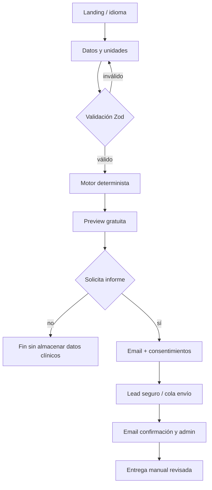

# PRD — AgeClarity

**Versión:** 4.0.0 | **Estado:** READY_TO_BUILD documental | **13 de octubre de 2026**

## 0. Ficha, versión y control

AgeClarity — especificación de producto v4.0.0; fecha 2026-10-13; estado READY_TO_BUILD (documentación), no certificación clínica ni software ya desarrollado. Propietario: equipo fundador. Idiomas es, en, pt-BR. Fuente normativa interna: etapa 3 conservada íntegra en original_stage3/.

## 1. Resumen ejecutivo

Aplicación web responsive que calcula Clinical PhenoAge a partir de edad y nueve biomarcadores de laboratorio; muestra una vista previa gratuita y captura solicitudes explícitas de un informe ampliado. La estimación es poblacional, no diagnóstico, pronóstico personal ni sustituto de atención médica.

## 2. Problema y evidencia

Problema: los usuarios disponen de analíticas comunes, pero les cuesta interpretarlas. La metodología publicada permite una estimación fenotípica reproducible; su transferencia a poblaciones fuera de la validación original requiere cautela. Evidencia y citas S201–S214 en docs/brief_estrategico.md y docs/qa_report.md; datos comerciales marcados preliminares.

## 3. Mercado y segmentos

B2C: adultos de 30–60 años con análisis recientes; segundo público: profesionales que ayudan a interpretar resultados; B2B2C futuro: laboratorios. TAM/SAM/SOM son escenarios y supuestos, no cifras verificadas de demanda. Priorizar Perú, México, España y Brasil mediante tests de adquisición; habilitar países luego de revisión legal.

## 4. Personas y JTBD

P1 adulto informado: “cuando recibo mi analítica quiero una explicación transparente para preparar una conversación con un profesional”. P2 familiar: “quiero leer límites y calidad de los datos antes de compartir un resultado”. P3 laboratorio: “quiero un informe reproducible, sin claims diagnósticos”. Evitar recomendaciones clínicas personalizadas.

## 5. Competencia

Alternativas: cálculo Clinical PhenoAge en herramientas abiertas, calculadoras genéricas, interpretación profesional y pruebas epigenéticas. Ventaja: claridad sobre unidades, versión científica, auditabilidad, documentación multilingüe e informe estructurado, no pretender novedad de la fórmula.

## 6. Propuesta de valor

Promesa: “Entiende la estimación PhenoAge de tus resultados, con transparencia sobre supuestos y limitaciones”. Vista previa en <90 s como objetivo UX medido; nueve biomarcadores obligatorios, sin OCR en MVP.

## 7. Alcance MVP / fuera de alcance / v2

MVP: entrada manual, validación estricta de unidades, cálculo exacto, visualización con advertencias, lead bajo consentimiento, email al usuario y aviso minimizado al propietario, PDF completo generado internamente solo para operación autorizada, panel admin mínimo, i18n. Fuera: OCR, diagnóstico, recomendaciones terapéuticas, benchmarking regional, percentiles, suscripción y predicción del tiempo de vida. V2: Stripe, historial con consentimiento específico, laboratorios, OCR sujeto a controles.

## 8. Flujo end-to-end

## 9. Historias de usuario (Gherkin)

US-01 Como visitante quiero introducir edad y nueve biomarcadores para calcular un resultado reproducible. GIVEN campos válidos WHEN envío THEN se muestra la edad fenotípica y brecha.
US-02 Como visitante quiero elegir unidades válidas. GIVEN unidad incompatible WHEN envío THEN se rechaza y muestra corrección.
US-03 Como usuario quiero ver explicación y límites. GIVEN preview WHEN leo THEN conozco que no es diagnóstico.
US-04 Como visitante quiero solicitar informe con consentimiento. GIVEN email verificado y opt-in WHEN solicito THEN se guarda lead y se envía confirmación.
US-05 Como administrador autorizado quiero revisar leads y reenviar correos sin mostrar salud en logs. GIVEN sesión admin WHEN consulto THEN veo información minimizada.
US-06 Como lector quiero cambiar ES/EN/PT. GIVEN idioma seleccionado WHEN navego THEN toda la interfaz principal respeta su locale.
US-07 Como operador quiero recibir el PDF solo por proceso autorizado. GIVEN solicitud válida WHEN genero informe THEN la entrega sigue el consentimiento registrado y queda auditada.
US-08 Como operador quiero continuidad si Drive no responde. GIVEN snapshot válido WHEN Drive falla THEN se usa último snapshot validado y se registra estado.

## 10. Requisitos funcionales y no funcionales

FR-01 entrada/validación US-01,US-02; FR-02 cálculo motor US-01; FR-03 preview/disclaimer US-03; FR-04 captura lead y preferencias US-04; FR-05 email y PDF con minimización US-04,US-07; FR-06 admin y reenvío US-05; FR-07 localización US-06; FR-08 Drive con validación checksum US-08; FR-09 analytics sin PHI US-03/US-04; FR-10 exportación/borrado de datos US-04.
NFR-01 p95 API cálculo <2s bajo carga objetivo de 50 req/min; NFR-02 Lighthouse móvil >=90 performance, accessibility, best practices, SEO en ruta pública; NFR-03 WCAG 2.2 AA; NFR-04 CSP, HTTPS, rate limit, Turnstile, RLS; NFR-05 no datos clínicos en PostHog/Sentry/URL; NFR-06 idempotencia de emails, reintentos y logs sin payload clínico; NFR-07 objetivo costo variable <=US$0.12/informe (hipótesis, validar con facturas); NFR-08 ES/EN/PT-BR; NFR-09 paridad numérica con tolerancia 1e-6 relativo.

## 11. Inputs

Contrato fuente: spec/inputs.schema.json. Capturar edad 20–84 y valores obligatorios con unidad explícita: albúmina, creatinina, glucosa, fosfatasa alcalina, PCR/CRP, linfocitos %, MCV, RDW, leucocitos. Prohibir NaN, infinito, CRP <= 0, campos faltantes y conversiones no autorizadas. El país no altera fórmula.

## 12. Modelo

Fuente: spec/model_spec.json, model/engine_reference.py, model/model_card.md, drive/model/coefficients.json y spec/test_vectors.json. Portar a TS de forma independiente sin copiar código GPL de terceras partes. Constante versión primaria 0.090165; escenario alternativo 0.09165 solo en informe completo. Sensibilidad +1% de uno en uno, sin atribución causal. Matemática estable en espacio logarítmico. Nunca usar IA generativa para cálculo.

## 13. Base de datos y Drive

SQL implementable: spec/db_schema.sql. API Drive: leer /Apps/ageclarity/ por nombre, según spec/drive_manifest.json, verificar SHA-256 antes de activar snapshot, cachear 24h; fallback snapshot local firmado/verificado; prohibir acceso público a service account. Escritura de usuarios en Supabase exclusivamente, NO guardar expedientes de usuario en Drive.

## 14. Outputs y acceso

Inventario contractual: spec/outputs_spec.json. Preview gratuito: phenoage, age_gap, gap_chart y free_insight. Completo sujeto a solicitud: local_sensitivity, formula_version_scenario, data_quality_audit, questions_for_professional, methodology. NO generar percentiles regionales ni tendencia como disponible en v1.

## 15. UX/UI

Usar ux/ux_spec.md, ux/sitemap_flows.md, ux/components.md, ux/prototype.html y spec/design_tokens.json. Formularios con etiquetas, unidad visible y ayudas. Diseño sobrio médico-informativo, sin alarmismo. Estados loading/error/éxito, validación inline, mobile-first.

## 16. Informe PDF

Referencia ux/report_layout.md y drive/templates/report_template.json. PDF multilingüe incluye fecha UTC, versión del modelo, valores normalizados, preview, tabla sensibilidad (+1%), escenario alternativo, metodología, advertencias, fuente y sello “solo informativo”. Nunca afirmar años causados por un biomarcador.

## 17. Monetización y tracción

MONETIZATION_MODE=validation. CTA solicita informe; no checkout ni cobro activo. spec/monetizacion.json fija objetivo >=12% preview→email, >=100 previews antes de valorar cobro y >=15 entrevistas; lab piloto futuro. Stripe activable solo con flag y revisión legal. Precios locales PPP son hipótesis preliminares.

## 18. Emails

Resend. Mensaje al usuario: confirmación de solicitud con ID y aviso privacidad, sin biomarcadores en asunto. Mensaje al owner: [AgeClarity] Solicitud de informe <id>; por defecto solo ID, fecha y enlace admin seguro; PDF y detalle clínico disponibles únicamente en panel con autorización y consentimiento específico, no adjuntos en claro. Reenvío admin auditado. SPF/DKIM/DMARC requeridos.

## 19. Arquitectura y stack

Next.js App Router TS strict; Tailwind + shadcn/ui; API Route Handlers; motor puro TypeScript; Zod; Supabase Postgres+RLS; Drive API server-only service account; @react-pdf/renderer; next-intl ES/EN/PT-BR; Resend; Turnstile + rate limit; PostHog/Sentry con scrubbing; Vitest/Playwright; GitHub Actions; Vercel principal, Netlify alternativa. Stripe bajo flag.

## 20. API

Contrato completo spec/openapi.yaml: POST /api/v1/calculate (stateless), POST /api/v1/leads (consentimiento + referencia a cálculo minimizado), GET /api/v1/leads/{id} admin, POST /api/v1/leads/{id}/resend admin, GET /api/v1/health, POST /api/v1/stripe/webhook deshabilitada por flag. Nunca enviar datos de salud en query strings.

## 21. Modelo de datos y RLS

spec/db_schema.sql: leads, consent_records, calculations, email_deliveries, audit_log, webhook_events; tablas con RLS, sin SELECT público, escritura servidor mediante rol service exclusivo, panel admin por función auth uid y allowlist; minimización y TTL. La anon key jamás debe permitir exfiltrar leads.

## 22. Seguridad, privacidad y legal

Datos de analítica sanguínea pueden ser sensibles. Privacidad por diseño y evaluación de bases legales/consentimiento, retención/borrado, transferencias transfronterizas y DPA antes de lanzamiento. Revisar GDPR, CCPA/CPRA, LGPD y Ley peruana 29733 según público efectivo. Mensajes informativos y no clínicos; revisión legal/regulatoria antes de publicar claims. Seguridad TLS, CSP, noindex admin, secretos server-only, MFA admin, auditoría y response plan.

## 23. Accesibilidad e i18n

WCAG 2.2 AA, navegación teclado, lectores de pantalla, contraste AA, formatos locales de número sin alterar almacenamiento normalizado; locales es/en/pt-BR, rutas /es /en /pt, hreflang, tests de traducciones completas.

## 24. Analítica y KPIs

Eventos whitelist en spec/analytics_events.json: landing_view, form_start, preview_view, report_cta, lead_submitted, email_sent, error_validation. Solo locale, país seleccionado como categoría no sensible y versión; sin valores clínicos, email ni identificadores persistentes de salud. Funnel visit→start >=45%, start→preview >=60%, preview→email >=12%.

## 25. SEO y adquisición

Landing indexable ES/EN/PT-BR, FAQ explicativa, páginas de interpretación educativa sin SEO clínico engañoso, schema.org SoftwareApplication cuando corresponda y canonical+hreflang. Experimentos de video educativo TikTok/Reels; claims verificados y enlaces a metodología. No prometer diagnóstico.

## 26. Plan de pruebas

unit Vitest + golden vectors completos, negativos, conversiones y fallback; contract OpenAPI, Playwright e2e desde formulario a lead/email simulado, tests RLS y permisos, amenazas OWASP, a11y axe y Lighthouse CI. docs/ACCEPTANCE_TESTS.md fija gates.

## 27. Despliegue y operación

Dev/staging/prod separados; GitHub Actions typecheck/lint/unit/e2e/dependency scan; Vercel secret store; Supabase migrations; deploy staging; smoke test; preview manual; despliegue gradual; alertas Sentry, backup y restore, rotación secretos; Drive service account con privilegios mínimos. Docs: DRIVE_SETUP.md, LAUNCH_CHECKLIST.md.

## 28. Definition of Done

Todos golden vectors PASS; TypeScript strict sin errores; CI verde; RLS probado; idiomas sin cadenas faltantes; emails con consentimiento y entrega segura; Drive checksum/cache/fallback probado; admin con MFA; Lighthouse móvil >=90; p95 <2s; políticas legales publicadas; smoke test en staging y producción; aceptación comercial y legal. READY_TO_BUILD no significa que estos gates ya hayan sido ejecutados.

## 29. Riesgos

R1 interpretación como diagnóstico (mitigar copy y revisión clínica), R2 parámetros PhenoAge y discrepancia histórica (golden tests/verificación fuentes), R3 filtración datos sensibles (minimización/RLS), R4 falla Drive (snapshot), R5 error de unidades (Zod+test), R6 regulación por país, R7 métricas de adquisición insuficientes. Documentar incidentes y no lanzar con riesgos críticos abiertos.

## 30. Supuestos

Público con laboratorios completos; unidades disponibles; validez general en población internacional NO demostrada; precios PPP y unit economics preliminares; no se requiere modelo entrenado; la solicitud y entrega manual requieren consentimiento; preview ideal <90 segundos no verificado aún.

## 31. Trazabilidad

US-01 → FR-01,FR-02 → AT-01,AT-02,AT-03; US-02 → FR-01 → AT-02; US-03 → FR-03,FR-09 → AT-04,AT-12; US-04 → FR-04,FR-05,FR-10 → AT-05,AT-06,AT-14; US-05 → FR-06 → AT-07,AT-08; US-06 → FR-07 → AT-09; US-07 → FR-05 → AT-06,AT-10; US-08 → FR-08 → AT-11,AT-13.

## 32. Anexos y decisiones

Paquete original acumulativo: original_stage3/. Especificaciones: spec/. Pruebas: docs/ACCEPTANCE_TESTS.md. Historial: docs/decisions_log.md y handoff.json. Brief: docs/brief_estrategico.md. QA previo: docs/qa_report.md. Limitaciones y asuntos abiertos: docs/final_audit.md.
