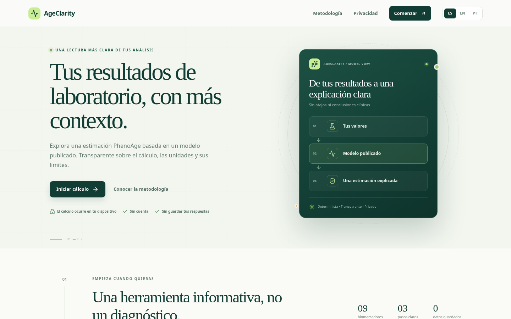
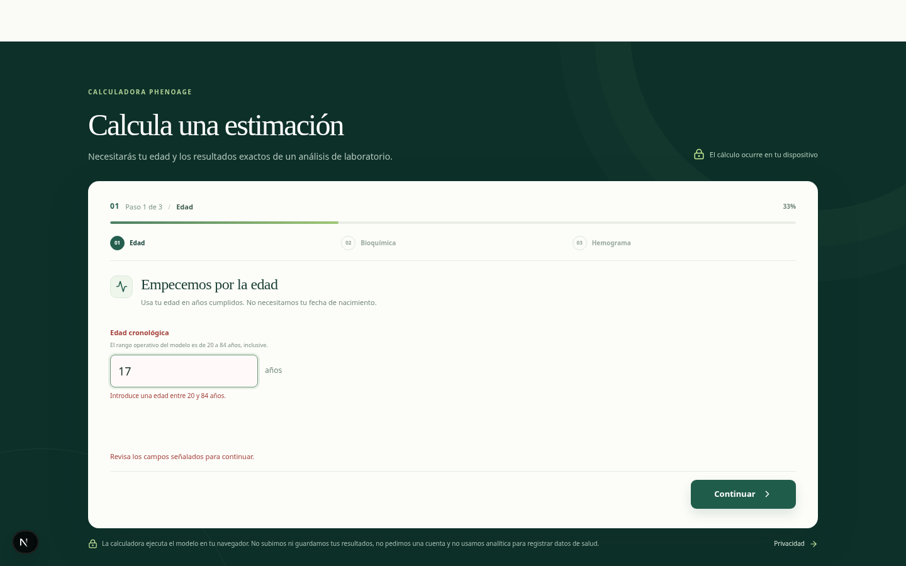
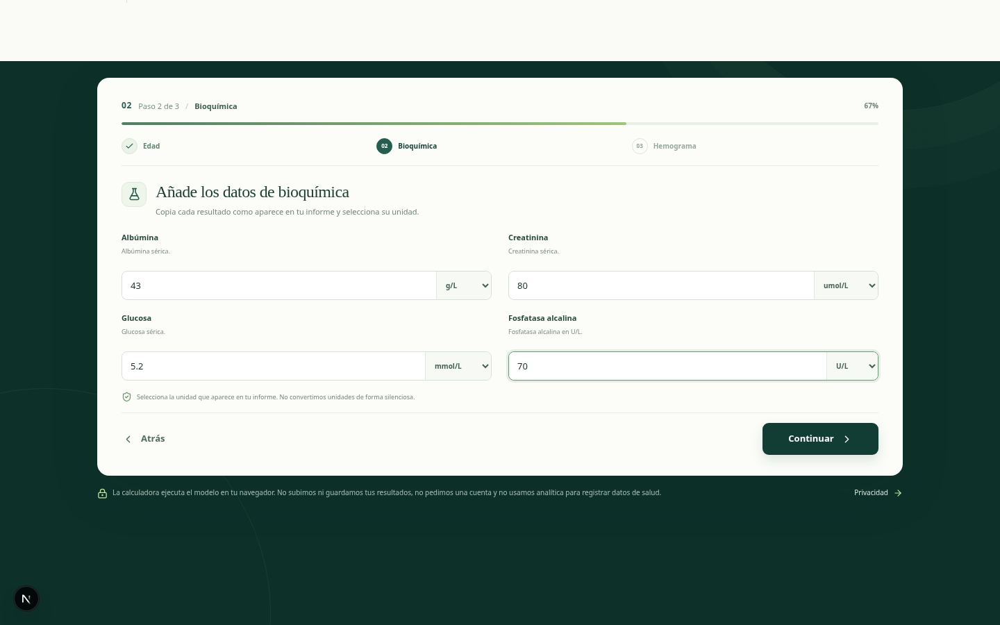
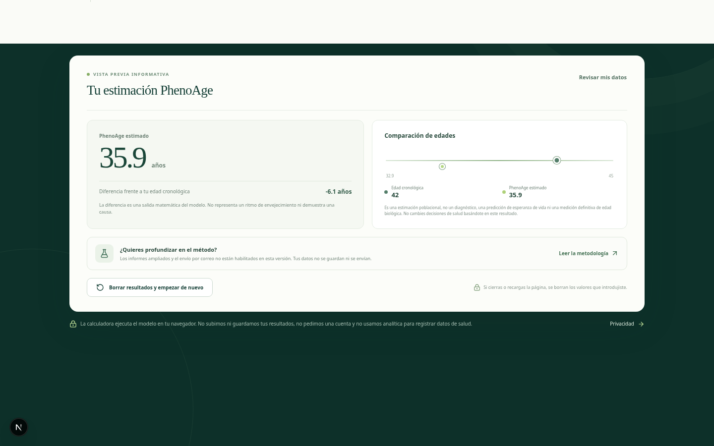
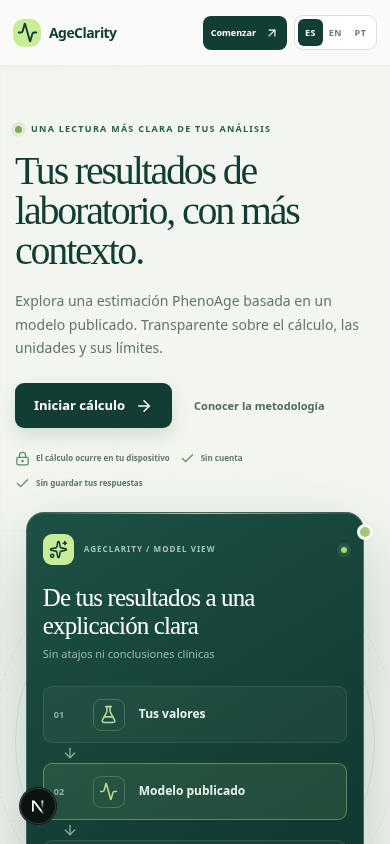
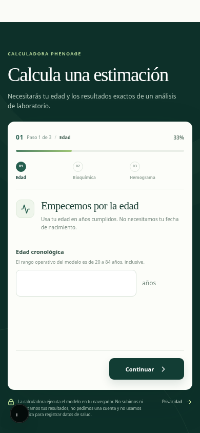
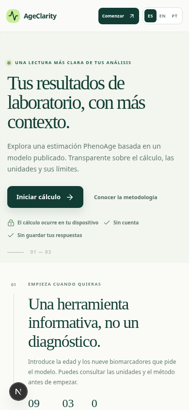
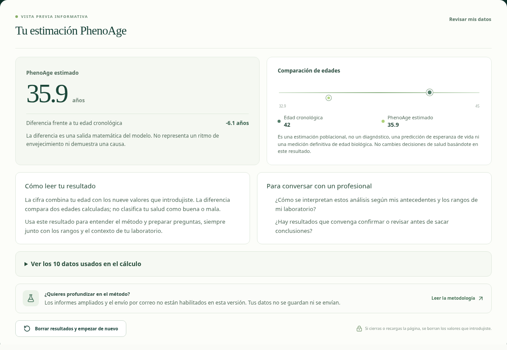
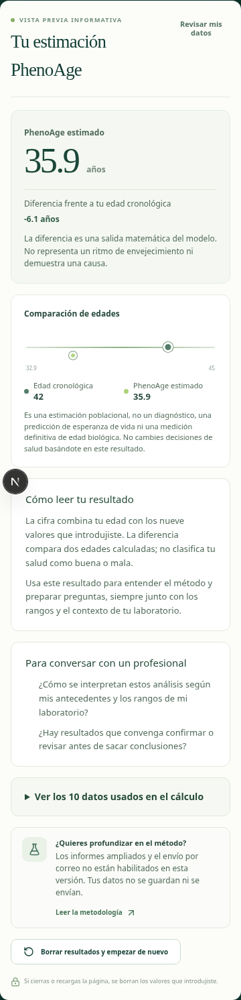

# AgeClarity: auditoría de experiencia previa a los cambios

Fecha: 15 de octubre de 2026. Superficie: versión local de la rama `main` en Chromium, 1440 × 900 y 390 × 844. Flujo: aterrizar, introducir datos, corregir un error y leer el resultado. Las imágenes de esta carpeta se capturaron antes de las mejoras de esta rama.

## Recorrido y hallazgos

1. **Inicio, escritorio — bueno.** La promesa, el método y la privacidad son visibles. El llamado a calcular es claro. La ilustración comunica el proceso, pero consume espacio que en móvil retrasa la calculadora.

   

2. **Edad inválida — bueno con ajuste de lectura.** Una edad de 17 años recibe un mensaje junto al campo y mantiene el valor para corregirlo. La ayuda, el error y otras notas usan letra demasiado pequeña.

   

3. **Bioquímica — aceptable.** Los valores y sus unidades están juntos. Las ayudas apenas explican cómo identificar cada análisis; antes del resultado no hay una revisión consolidada de las conversiones.

   

4. **Resultado — requiere mejora prioritaria.** El cálculo de ejemplo muestra 35,9 años para una edad de 42, pero entrega esencialmente dos cifras y un gráfico. No explica cómo revisar los valores usados ni ofrece preguntas útiles para interpretar el informe con un profesional. El texto de límites es muy pequeño.

   

5. **Inicio móvil — requiere mejora.** El encabezado y la acción principal caben, pero la ilustración ocupa gran parte de la primera pantalla y desplaza el producto hacia abajo.

   

6. **Formulario móvil — aceptable con ajuste de espacio.** El campo y la acción principal son accesibles a simple vista; el espacio vacío y el texto auxiliar pequeño hacen más larga y difícil la lectura.

   

## Prioridades derivadas

1. Añadir lectura cuidadosa del resultado, preguntas para consulta y revisión de valores normalizados sin atribuir causalidad ni diagnóstico.
2. Aumentar el tamaño del texto auxiliar y compactar el formulario; priorizar el acceso a la calculadora en móvil.
3. Preparar una solicitud de correo con consentimiento, minimización y controles de abuso antes de activarla. El código anterior no contiene ruta de solicitud, registro de consentimiento, protección del endpoint ni configuración de Resend.

## Decisión respecto al playbook de monetización

El documento adjunto propone enviar el PDF completo y los análisis al buzón del dueño. AgeClarity maneja posibles datos de salud: esa transferencia ampliaría la exposición y contradice la minimización del PRD. La primera integración enviará solo correo y estado de solicitud, con consentimiento explícito; los biomarcadores continuarán en el navegador. El PDF y los pagos requieren un diseño de acceso, retención, revisión legal y pruebas independientes antes de habilitarse.

## Alcance de la evidencia

Estas capturas muestran el aspecto y el recorrido local antes del cambio. No demuestran cómo funciona el despliegue de Vercel, la entrega de correo, lectores de pantalla, contraste medido ni cumplimiento WCAG. El ejemplo usa valores sintéticos del vector T01 del repositorio, no datos de una persona real.

## Pantallas después de las mejoras

El inicio móvil deja la calculadora más cerca y elimina la ilustración larga de la primera pantalla:

El resultado añade contexto, preguntas y control desplegable de los datos usados. El formulario de correo no aparece porque continúa desactivado:

