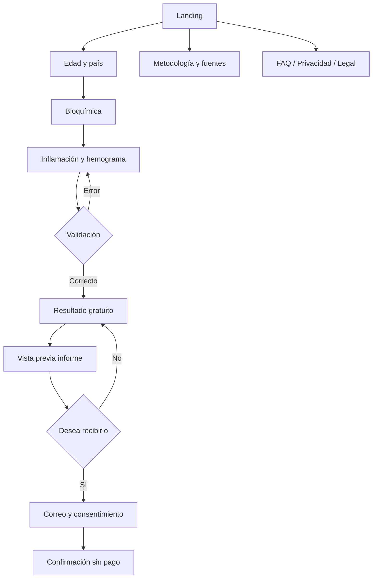

# Sitemap y flujos

Rutas: `/`, `/calcular`, `/resultado`, `/informe`, `/gracias`, `/metodologia`, `/faq`, `/privacidad`, `/terminos`, `/admin`. Localización por prefijo `/es-pe`, `/es-mx`, `/es-es`, `/pt-br`, `/en`.
